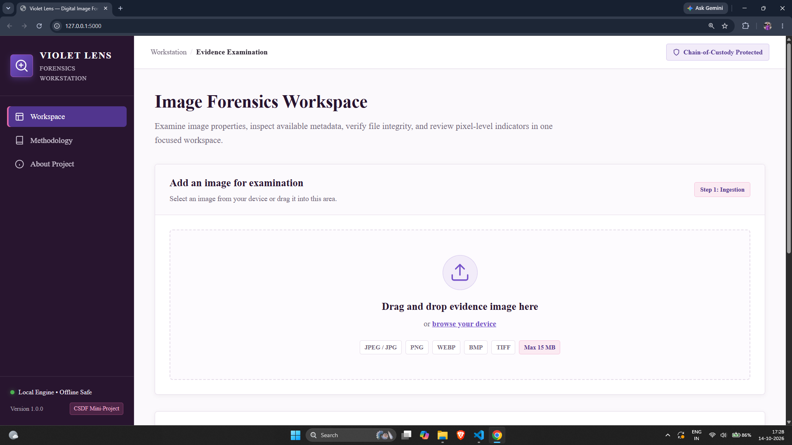
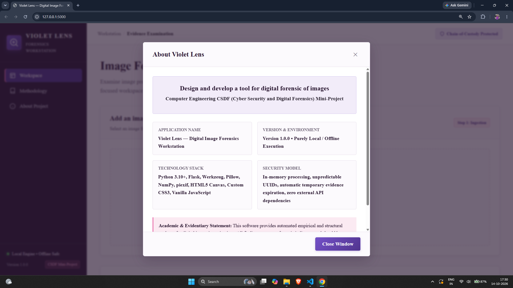
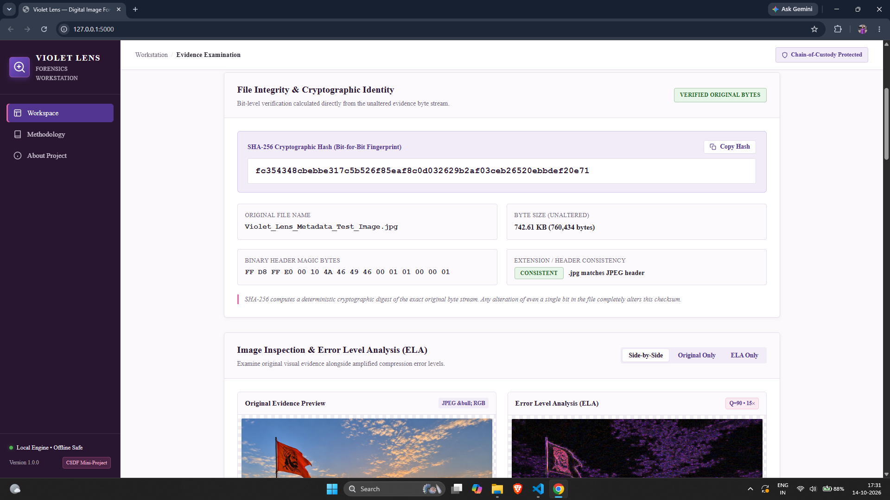
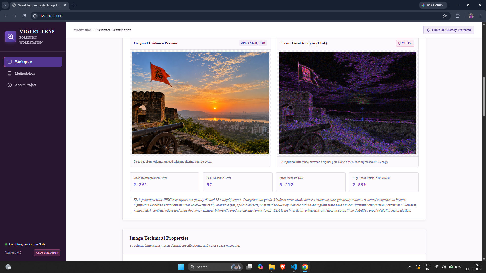
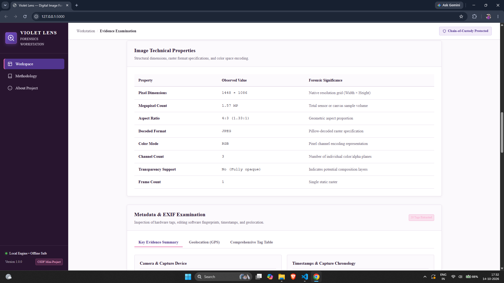
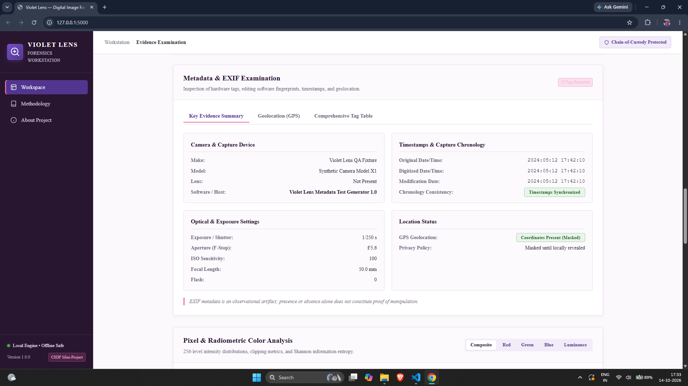
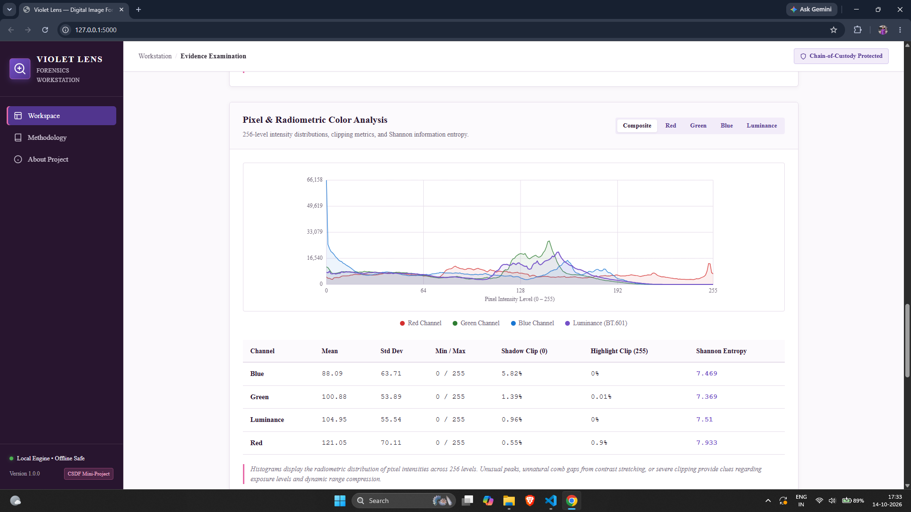
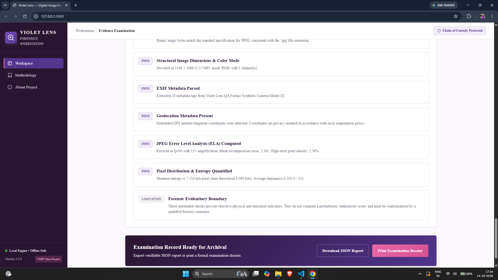

# Violet Lens — Digital Image Forensics Workstation

[](https://python.org)
[](https://palletsprojects.com/p/flask/)
[]()
[](LICENSE)
[](https://github.com/shravanshidruk16/Violet-Lens-Digital-Image-Forensics-Workstation.git)

> **Computer Engineering CSDF (Cyber Security and Digital Forensics) Mini-Project**  
> **Exact Syllabus Project Title:** *"Design and develop a tool for digital forensic of images"*  
> **Application Name:** Violet Lens — Digital Image Forensics Workstation  
> **Repository:** [https://github.com/shravanshidruk16/Violet-Lens-Digital-Image-Forensics-Workstation.git](https://github.com/shravanshidruk16/Violet-Lens-Digital-Image-Forensics-Workstation.git)  
> **Version:** 1.0.0 (Local Offline Workstation)

---

## 1. Project Overview & Problem Statement

Digital imagery serves as a primary evidentiary medium in cyber investigations, law enforcement, journalism, and legal proceedings. However, modern desktop photo editing suites make raster tampering, spliced composites, metadata manipulation, and container obfuscation trivial to execute.

**Exact Syllabus Problem Statement:**  
*"Design and develop a tool for digital forensic of images"*

**Problem Analysis:**  
Commercial forensics platforms are frequently proprietary, cost-prohibitive, cloud-tethered (threatening chain-of-custody integrity and evidentiary privacy), or black-box in nature. Conversely, ad-hoc open-source utilities often lack a coherent investigation workflow or generate opaque, fabricated "authenticity scores" that fail courtroom evidentiary standards.

**Project Objectives:**  
1. **Verifiable Ingestion:** Ingest digital evidence without modifying source bytes, calculating deterministic SHA-256 cryptographic fingerprints.
2. **Container Consistency:** Inspect binary magic bytes to detect file-extension spoofing and container anomalies.
3. **Deep Metadata Audit:** Extract and parse EXIF/TIFF IFDs, flag editing software fingerprints (e.g. Adobe Photoshop, GIMP), audit timestamps, and enforce privacy controls on GPS geolocation.
4. **Heuristic Error Analysis:** Implement genuine JPEG Error Level Analysis (ELA) with documented recompression ($Q=90, 15\times$) while rejecting non-JPEG sources honestly.
5. **Radiometric Distribution:** Compute 256-bin channel histograms, dynamic range clipping, and Shannon information entropy using NumPy and HTML5 Canvas.
6. **Archival Reporting:** Produce verifiable, schema-compliant JSON examination exports and formal browser-printable forensic dossiers.

---

## 2. Screenshots & Application Outputs

Below are genuine screenshots captured directly from the running Violet Lens workstation across the full forensic lifecycle:

### A. Main Application Interface & Ingestion

*Figure 2.1: Violet Lens workstation dashboard featuring the editorial purple-and-pink design, deep aubergine sidebar, drag-and-drop evidence drop zone, supported container chips (JPEG, PNG, WebP, BMP, TIFF), and the six forensic capability summaries.*

---

### B. Scientific Foundations & Project Overview Modals
| Forensic Methodology Modal | Project & Academic Overview Modal |
|---|---|
|  |  |
| *Figure 2.2: Scientific methodology modal explaining SHA-256 hashing, magic bytes, EXIF parsing, and ELA principles.* | *Figure 2.3: Project information modal detailing the CSDF syllabus attribution, technology stack, and offline security model.* |

---

### C. File Integrity & Cryptographic Identity

*Figure 2.4: Cryptographic integrity panel showing the bit-for-bit SHA-256 hash digest, one-click copy button, verified original byte size, magic byte verification, and extension-to-header consistency status.*

---

### D. Error Level Analysis (ELA) & Image Inspection

*Figure 2.5: Dual image inspection workspace displaying the original evidence alongside the genuine JPEG Error Level Analysis (ELA) visualization ($Q=90, 15\times$ amplification), empirical error metrics (mean, peak, standard deviation, high-error pixel density), and scientific interpretation notes.*

---

### E. Image Technical Specifications & EXIF Examination
| Technical Properties Table | Metadata & EXIF Examination |
|---|---|
|  |  |
| *Figure 2.6: Structural image properties including native raster dimensions, megapixels, aspect ratio, color mode, channel count, and transparency status.* | *Figure 2.7: Metadata inspection panel displaying camera hardware, capture timestamps, optical parameters, editing software flags (Adobe Photoshop detection), and privacy-masked GPS geolocation.* |

---

### F. Radiometric Pixel Histograms & Archival Dossier Export
| Radiometric Pixel Histograms | Archival Findings & Dossier Export |
|---|---|
|  |  |
| *Figure 2.8: Interactive HTML5 Canvas histogram with channel filters (Red, Green, Blue, Luminance) alongside channel statistics, clipping percentages, and Shannon entropy.* | *Figure 2.9: Archival export panel featuring deterministic findings categorized into Information, Needs Review, and Limitations, alongside JSON download and printable dossier export buttons.* |

---

## 3. Core Forensic Capabilities

### A. Cryptographic File Integrity (SHA-256)
- Computes a deterministic 256-bit digest directly from the unaltered uploaded byte stream before any decoding or preview generation.
- Records exact byte size and human-readable units.
- Issues an unpredictable UUIDv4 examination identifier with an ISO 8601 UTC timestamp.
- One-click copy with instant visual confirmation.

### B. File Signature & Container Consistency
- Reads initial binary header bytes ("magic bytes"):
  - **JPEG / JFIF:** `FF D8 FF`
  - **PNG:** `89 50 4E 47 0D 0A 1A 0A`
  - **WebP:** `RIFF....WEBP`
  - **TIFF:** `II*\x00` (Little-Endian) or `MM\x00*` (Big-Endian)
  - **BMP:** `BM`
- Detects extension spoofing and renaming discrepancies.

### C. EXIF & Metadata Audit
- Extracts hardware metadata (Make, Model, Lens Specification).
- Identifies image processing software tags (Adobe Photoshop, GIMP, Canva, Snapseed).
- Cross-references capture, digitization, and modification timestamps.
- Decodes optical settings: Shutter speed ($1/t$ s), F-stop, ISO sensitivity, Focal length, Flash.
- **Privacy Controls on GPS Data:** Embedded coordinates are masked by default to protect location privacy; analysts can reveal coordinates locally on demand.

### D. Error Level Analysis (ELA)
- Implements genuine JPEG Error Level Analysis:
  - Resaves image in memory at documented JPEG quality ($Q = 90$).
  - Computes absolute difference against normalized original pixels using NumPy.
  - Amplifies difference by $15\times$ for visual inspection.
  - Calculates empirical metrics: Mean error, peak absolute error, standard deviation, and high-error pixel density.
- Restricts ELA to JPEG sources; non-JPEG formats display an informative boundary notice rather than misleading artifacts.

### E. Radiometric Histograms & Shannon Entropy
- Real-time 256-level histogram generation for Red, Green, Blue, and Luminance (ITU-R BT.601) channels.
- Interactive HTML5 Canvas visualization with hi-DPI scaling and channel toggles.
- Shannon entropy computation (bits/pixel) to quantify information richness and compression loss.
- Quantifies shadow clipping (level $\le 1$) and highlight blowout (level $\ge 254$).

### F. Deterministic Forensic Observations
- Categorizes findings into three visual priorities:
  - **Information (`info`)**: Empirical facts (SHA-256 fingerprint, resolution, camera hardware).
  - **Needs Review (`review`)**: Editing software tags, timestamp divergence, header mismatches, extreme clipping.
  - **Analysis Limitation (`limitation`)**: Format boundaries, metadata absence notes, heuristic interpretation limits.

### G. Archival Reports & Dossier Export
- **JSON Export:** Complete, schema-validated JSON report (`/api/examinations/<id>/report.json`).
- **Printable Dossier:** Standalone browser-printable HTML dossier with clean white background, formal header, figures, and an examiner attestation/signature block (`/examinations/<id>/report`).

---

## 4. Technology Stack & Design Decisions

### Backend
- **Python 3.10+**: Core programming language.
- **Flask (v3.1.x)**: Lightweight WSGI server for local offline execution with zero cloud dependency.
- **Werkzeug**: Enforces request entity ceilings (`MAX_CONTENT_LENGTH = 15MB`) and filename sanitization (`secure_filename`).
- **Pillow (PIL Fork v11.x)**: Safe image validation, format inspection, decompression bomb protection (`MAX_IMAGE_PIXELS = 50M`), and in-memory JPEG recompression.
- **NumPy (v2.x)**: Vectorized array calculations for ELA differences, 256-bin histograms, clipping statistics, and Shannon entropy.
- **piexif (v1.1.3)**: Low-level EXIF IFD parsing for complex JPEG/TIFF tags and GPS rational tuples.
- **hashlib**: Built-in standard library cryptographic SHA-256 implementation.

### Frontend
- **HTML5 & Custom CSS3**: Pure custom implementation without external UI frameworks (no Tailwind, Bootstrap, React, or Node.js build steps).
- **Typography**: Editorial `"Times New Roman", Times, serif` consistently applied across all headings, navigation, buttons, tables, and numeric data.
- **Color Identity**:
  - Deep aubergine (`#28152F`) & Primary purple (`#7450C8`)
  - Accent pink (`#E76AA8`)
  - Pale lavender (`#F2ECF9`) & Soft rose (`#FBEAF2`)
  - Warm near-white background (`#FBF9FC`)
- **HTML5 Canvas API**: Custom histogram rendering engine with hi-DPI scaling.
- **Vanilla JavaScript**: Modular ES6 classes (`UploadController`, `AnalysisController`, `HistogramRenderer`, `VioletLensApp`).

---

## 5. System Architecture

```
                                  [ Client Browser ]
                                          |
                        (Multipart POST / API Requests)
                                          v
                                  [ Flask WSGI App ]
                                          |
                +-------------------------+-------------------------+
                |                         |                         |
                v                         v                         v
       [ Evidence Ingestion ]    [ Forensic Pipeline ]     [ Archival Exporter ]
       - 15 MB Size Guard        - SHA-256 Hashing         - JSON Report Engine
       - Decompression Bomb Prot - Magic Byte Detection    - Printable HTML Dossier
       - Secure Temporary Cache  - EXIF / GPS Parsing      - A4 Print Stylesheet
                                 - JPEG Error Level (ELA)
                                 - NumPy Histograms & Ent.
                                 - Deterministic Findings
```

---

## 6. Project Directory Structure

```
d:/CSDF Mini Project/
├── app.py                             # Flask application factory, routes, and security filters
├── config.py                          # Workstation configuration and operational thresholds
├── LICENSE                            # MIT License (Copyright 2026 Shravan Shidruk)
├── requirements.txt                   # Production Python dependencies
├── requirements-dev.txt               # Testing & development dependencies
├── .env.example                       # Local configuration template
├── .gitignore                         # Repository exclusion rules
├── README.md                          # Comprehensive project documentation
│
├── forensic/                          # Modular digital forensics analysis engine
│   ├── __init__.py                    # Package metadata and version definition
│   ├── integrity.py                   # SHA-256 hashing and chain-of-custody tracking
│   ├── file_signature.py              # Magic byte detection and extension consistency
│   ├── image_loader.py                # Safe image loading and decompression bomb guards
│   ├── metadata.py                    # EXIF extraction and privacy-masked GPS decoding
│   ├── ela.py                         # Error Level Analysis recompression and metrics
│   ├── pixel_analysis.py              # NumPy radiometric histograms, entropy, and clipping
│   ├── observations.py                # Deterministic finding categorization
│   └── report.py                      # Structured report assembly and JSON export
│
├── images/                            # High-resolution application screenshots for README
│   ├── home.png                       # Workstation dashboard & ingestion panel
│   ├── methodology.png                # Scientific methodology modal
│   ├── about.png                      # Project & academic overview modal
│   ├── result1.png                    # SHA-256 integrity & signature results
│   ├── result2.png                    # ELA visualization & error metrics
│   ├── result3.png                    # Technical properties table
│   ├── result4.png                    # EXIF metadata & software tag inspection
│   ├── result5.png                    # Pixel histograms & channel statistics
│   └── final_result_download.png      # Archival report export & findings cards
│
├── templates/                         # Jinja2 HTML templates
│   ├── index.html                     # Main workstation interface
│   ├── report.html                    # Formal printable examination dossier
│   └── errors/                        # Structured error views
│       ├── 400.html
│       ├── 404.html
│       └── 500.html
│
├── static/                            # Frontend static assets
│   ├── css/
│   │   ├── styles.css                 # Main purple-and-pink editorial design system
│   │   └── print.css                  # Print/PDF optimization stylesheet
│   └── js/
│       ├── app.js                     # Navigation, modals, and app lifecycle
│       ├── upload.js                  # Drag-and-drop, validation, and upload handler
│       ├── analysis.js                # Forensic result presentation controller
│       └── charts.js                  # HTML5 Canvas histogram renderer
│
├── tests/                             # Automated pytest suite (26 passing tests)
│   ├── conftest.py                    # Test fixtures and in-memory test image generators
│   ├── test_upload.py                 # Upload validation, format, and edge cases
│   ├── test_integrity.py              # SHA-256 hash preservation tests
│   ├── test_metadata.py               # EXIF parsing and malformed tag handling
│   ├── test_ela.py                    # ELA recompression and format boundary tests
│   ├── test_reports.py                # JSON schema and printable HTML report tests
│   └── test_api.py                    # API routes and defensive security header tests
│
├── instance/                          # Local runtime storage (excluded from git except .gitkeep)
│   ├── .gitkeep
│   └── examinations/
│       └── .gitkeep
│
└── docs/                              # In-depth architectural documentation
    ├── methodology.md                 # Scientific foundations and signal processing
    ├── security.md                    # Evidence handling, retention, and privacy
    └── test-plan.md                   # Test matrix and manual verification steps
```

---

## 7. Installation & Execution Guide

### Prerequisites
- Python 3.10 or higher
- Git 2.20 or higher
- Modern web browser (Chrome, Edge, Firefox, Safari)

### Windows PowerShell

```powershell
# 1. Clone the repository
git clone https://github.com/shravanshidruk16/Violet-Lens-Digital-Image-Forensics-Workstation.git
cd Violet-Lens-Digital-Image-Forensics-Workstation

# 2. Create a Python virtual environment
python -m venv .venv

# 3. Activate the virtual environment
.\.venv\Scripts\Activate.ps1

# 4. Install dependencies
python -m pip install --upgrade pip
pip install -r requirements.txt
pip install -r requirements-dev.txt

# 5. Launch the Violet Lens workstation
python app.py
```

### macOS & Linux

```bash
# 1. Clone the repository
git clone https://github.com/shravanshidruk16/Violet-Lens-Digital-Image-Forensics-Workstation.git
cd Violet-Lens-Digital-Image-Forensics-Workstation

# 2. Create and activate a virtual environment
python3 -m venv .venv
source .venv/bin/activate

# 3. Install dependencies
python3 -m pip install --upgrade pip
pip install -r requirements.txt
pip install -r requirements-dev.txt

# 4. Launch the application
python3 app.py
```

**Workstation URL:** [http://127.0.0.1:5000/](http://127.0.0.1:5000/)

---

## 8. Examination Workflow

1. **Ingest Evidence:** Drag and drop an image (JPEG, PNG, WebP, BMP, TIFF) or browse local files. The workstation validates file size ($\le 15$ MB) and format headers.
2. **Execute Pipeline:** Click "Analyze Image". The workstation extracts the unaltered byte stream, calculates the SHA-256 hash, verifies binary magic bytes, extracts EXIF metadata, executes JPEG ELA, and calculates radiometric pixel histograms.
3. **Inspect Integrity & Properties:** Review the SHA-256 fingerprint, byte size, format consistency, and structural dimensions ($W \times H$).
4. **Evaluate ELA:** Compare the original evidence against the amplified JPEG compression error visualization using side-by-side or toggle controls.
5. **Audit Metadata:** Review camera device details, software processing tags (Photoshop/GIMP flags), capture timestamps, and privacy-shielded GPS coordinates.
6. **Analyze Radiometric Data:** Inspect 256-level RGB and Luminance histograms, shadow/highlight clipping, and Shannon entropy.
7. **Export Findings:** Download the schema-compliant JSON examination report or generate a formal browser-printable forensic dossier with an attestation block.

---

## 9. Automated Testing & Verification

The project includes an automated test suite implemented with `pytest` and Flask's test client.

Run the test suite:
```powershell
python -m pytest -v
```

Verified test execution:
```
tests/test_api.py::test_index_route PASSED                               [  3%]
tests/test_api.py::test_health_route PASSED                              [  7%]
tests/test_api.py::test_ela_image_endpoint PASSED                        [ 11%]
tests/test_api.py::test_security_headers_present PASSED                  [ 15%]
tests/test_api.py::test_path_traversal_prevention PASSED                 [ 19%]
tests/test_ela.py::test_valid_jpeg_ela_generation PASSED                 [ 23%]
tests/test_ela.py::test_non_jpeg_ela_marked_unavailable PASSED           [ 26%]
tests/test_ela.py::test_ela_error_resilience PASSED                      [ 30%]
tests/test_integrity.py::test_sha256_exact_hash_match PASSED             [ 34%]
tests/test_integrity.py::test_integrity_module_structure PASSED          [ 38%]
tests/test_integrity.py::test_api_integrity_preservation PASSED          [ 42%]
tests/test_metadata.py::test_metadata_extraction_with_exif PASSED        [ 46%]
tests/test_metadata.py::test_metadata_extraction_without_exif PASSED     [ 50%]
tests/test_metadata.py::test_corrupt_exif_does_not_crash PASSED          [ 53%]
tests/test_reports.py::test_full_report_structure PASSED                 [ 57%]
tests/test_reports.py::test_html_report_rendering PASSED                 [ 61%]
tests/test_reports.py::test_invalid_exam_id_rejected PASSED              [ 65%]
tests/test_reports.py::test_nonexistent_exam_id_returns_404 PASSED       [ 69%]
tests/test_upload.py::test_valid_jpeg_upload PASSED                      [ 73%]
tests/test_upload.py::test_valid_png_upload PASSED                       [ 76%]
tests/test_upload.py::test_valid_webp_upload PASSED                      [ 80%]
tests/test_upload.py::test_valid_bmp_upload PASSED                       [ 84%]
tests/test_upload.py::test_empty_upload_payload PASSED                   [ 88%]
tests/test_upload.py::test_missing_image_field PASSED                    [ 92%]
tests/test_upload.py::test_invalid_disguised_bytes PASSED                [ 96%]
tests/test_upload.py::test_extension_content_mismatch_detected PASSED    [100%]

============================= 26 passed in 0.36s ==============================
```

---

## 10. Privacy & Evidence Handling Policy

- **Unaltered Evidence Byte Stream:** SHA-256 hashing is executed directly on incoming bytes before any decoding or normalization.
- **Immutable Evidence:** Source evidence bytes are never overwritten, transcoded, or modified in place.
- **Decoupled Previews:** All browser visual displays and ELA outputs are separate, derived buffers.
- **Offline Local Execution:** Binds strictly to `127.0.0.1` by default; zero telemetry or external network calls.
- **Decompression Bomb Protection:** Pillow restricts images to a 50 Megapixel ceiling (`MAX_IMAGE_PIXELS = 50_000_000`).
- **Temporary Evidence Expiration:** Files in `instance/examinations/` have a 1-hour TTL and are purged automatically.
- **GPS Privacy Shield:** Embedded GPS coordinates are masked by default to protect location privacy.

---

## 11. Troubleshooting

| Issue | Cause | Solution |
|---|---|---|
| **PowerShell script execution error** | Execution policy restriction on Windows | Run: `Set-ExecutionPolicy -Scope Process -ExecutionPolicy Bypass` |
| **`ModuleNotFoundError: No module named 'piexif'`** | Missing dependencies | Activate `.venv` and run: `pip install -r requirements.txt` |
| **Port 5000 in use** | Another service occupies port 5000 | Set custom port: `$env:PORT="5050"; python app.py` |
| **"ELA Not Applicable" message** | Source image is PNG, WebP, BMP, or TIFF | ELA operates specifically on JPEG lossy compression; this is an expected scientific boundary. |
| **Upload rejected (413)** | Image exceeds 15 MB limit | Ensure the uploaded image is under 15 Megabytes. |

---

## 12. Future Development Roadmap

The application architecture is modular to support future AI-assisted forensic capabilities:
- **Deepfake & Synthetic Face Detection:** Integrate CNN/ViT models for GAN and diffusion artifact detection.
- **Copy-Move Forgery Localization:** Implement SIFT/SURF or keypoint-based block-matching algorithms.
- **Image Splicing Detection:** Introduce cross-channel noise inconsistency analysis.
- **Advanced Provenance Graphs:** Trace image dissemination across social web platforms.

---

## 13. License

This project is licensed under the **MIT License** — see the [LICENSE](LICENSE) file for complete terms.

```
Copyright (c) 2026 Shravan Shidruk
```

---

## 14. Academic Attribution

Developed for the **Computer Engineering Cyber Security and Digital Forensics (CSDF) Mini-Project** under the syllabus specification:  
*"Design and develop a tool for digital forensic of images"*.
